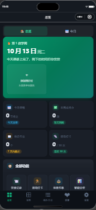
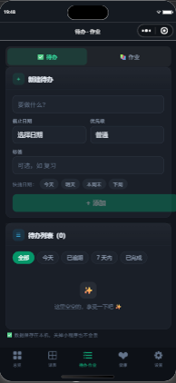
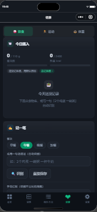
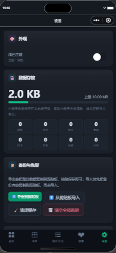

# 大学日程 · college-desk

把「今天有什么课、哪份作业快到期、这周运动了几次、体重记到哪儿了」收进一个微信小程序。

从桌面版移植而来，**数据键名与备份格式和桌面版逐字一致**，桌面版导出的备份可以原样导入。
**没有后端，也没有任何网络请求** —— 全部数据留在本机的小程序存储里。

自测：`440` 项全部通过（`miniprogram/tools/selftest.js`）。当前版本 **v1.1.0**（见 [CHANGELOG.md](CHANGELOG.md)）。

## 界面

| 总览 | 课表 | 待办·作业 |
| --- | --- | --- |
|  |  |  |

| 健康 | 设置 |
| --- | --- |
|  |  |

以上是开发者工具模拟器里的真机渲染截图，更多页面在 `miniprogram-preview/realshots/`。

## 功能一览

底部菜单只能放 5 项（微信硬限制），其余功能从 **总览 → 全部功能** 进。

| 模块 | 入口 | 内容 |
| --- | --- | --- |
| 总览 | 菜单 ① | 确认「现在是第几教学周」；今日课程时间轴；待办 / 作业 DDL 倒计时；指标卡与全部功能入口 |
| 今日 | 总览内分段 | 按日期前后翻看当天课程、待办、作业 |
| 课表 | 菜单 ② | 课程增删改；周次规则认「第 N 周」「1,3,5 周」「3-16 周」这类写法 |
| 待办·作业 | 菜单 ③ | 两段：**待办清单** / **作业 DDL**（按课程分组、逾期标红） |
| 健康 | 菜单 ④ | 三段：**饮食记录**（食物库 + 蛋白质目标）/ **运动打卡**（周目标、训练日）/ **体重作息**（体重 / 睡眠 / 步数） |
| 设置 | 菜单 ⑤ | 深色·浅色主题；数据用量；备份导入导出；学期起点与总周数；导入作息表；蛋白质系数；运动打卡开关 |
| 周计划 | 总览 → 全部功能 | 一周课程网格，标出当前周与今天 |
| 课表识别 | 总览 → 全部功能 | 粘贴教务系统文字 → 解析 → 逐条核对 → 导入；自带给 AI 的整理提示词 |
| 校历识别 | 总览 → 全部功能 | 校历文字 → 关键日期（报到/上课/考试/放假）→ 确认后写入重要事项，并可反推学期起点 |
| 重要事项 | 总览 → 全部功能 | 考试 / 竞赛 / 证书 / 报名……自由增删，带常用模板与倒计时 |
| 智能分析 | 总览 → 全部功能 | 空闲时段分析：7 天 × 时段的整体空闲度，推荐最空闲的时段 |

## 快速开始

1. 打开**微信开发者工具** → 导入项目
2. 目录选 **`miniprogram/`**（不是仓库根目录）
3. AppID 用 `project.config.json` 里那个测试号即可跑起来；要发布就换成自己的
4. 基础库 `3.17.4`（`libVersion`）

没有 npm 依赖，不用 `npm install`，也不需要构建步骤。
`tools/` 已在 `packOptions.ignore` 里排除，不进小程序包；小程序包体（不含 `tools/`）约 **584 KB**。

## 目录结构

```
miniprogram/               ← 小程序本体，开发者工具导入这个目录
├── app.js / app.json     入口；页面注册（16 个页面）、tabBar、全局深色兜底
├── app.wxss              全局样式与主题 CSS 变量
├── pages/                16 个页面（5 个在底部菜单，其余从「全部功能」进）
├── store/store.js        全局单例数据仓库：hydrate 一次读盘，写入后 notify 广播
├── utils/                storage 存储 / schedule 课表派生 / plan 学期 / weeks 周次
│                         / periods 作息 / theme 主题 / chart canvas 图表 / textParse 解析
├── data/foods.js         食物库 + 蛋白质目标算法
├── version.js            版本号唯一真源（「设置 → 关于」读它）
└── tools/                自测与静态检查（不进小程序包）

miniprogram-preview/      页面静态渲染出的 HTML 与截图（**不是**小程序代码，不参与打包）
docs/                     小程序头像素材与生成脚本、给 Agent 的工程约定
CHANGELOG.md              版本更新记录
```

## 数据与隐私

- **只在本地**：整个仓库没有 `wx.request` / `wx.cloud` / `uploadFile` / `downloadFile` 调用。
- 13 个存储键，统一 `fitplan-*` 前缀（`utils/storage.js` 集中登记）：`health` `trainDone` `diet` `dietSeed` `run` `courses` `todos` `assignments` `templates` `settings` `notes` `milestones` `calendars`。
- 键名和数据形状与桌面版一致，所以：**桌面版的备份能直接导进小程序，反之亦然**。
- 设置页可以导出 / 导入 JSON（走剪贴板）、清理缓存、清空全部数据。

## 分享

16 个页面都能**转发给好友**和**分享到朋友圈**，文案集中在 `utils/share.js`：

- 标题按页面走；合并页跟着**当前分段**变（「运动打卡 · 每周目标」而不是笼统的「健康」）。
- 落地路径指向本页，合并页带上分段（`/pages/healthhub/healthhub?seg=run`），
  对方点开就停在同一段，而不是默认的第一段。
- 两个回调的返回值形状不一样：转发是 `path`，朋友圈是 `query` 且**不带开头问号**。

> ⚠️ 分享出去的是**没有数据的**：本应用无后端、无登录，所有记录都在分享者自己手机上，
> 对方点开看到的是他自己的空记录。所以文案只描述「这个工具能做什么」，
> 不写「我的课表」「我的体重」这类只有分享者看得到的内容。

## 开发与自测

只用 Node 跑，无需安装依赖：

```powershell
# 行为自测：用假的 wx / App / Page 在 Node 里真跑 onLaunch 和每个页面的生命周期
node miniprogram/tools/selftest.js "$PWD/miniprogram"   # 440 通过 / 0 失败

# 静态检查：WXML 里绑定的事件处理器在 JS 里是否真的存在（含合并页的前缀解析）
node miniprogram/tools/check-handlers.js miniprogram

# 静态检查：WXML 里的 {{item.xxx}} 是否对应真实字段（输出待人工确认的清单，不是通过/失败）
node miniprogram/tools/check-item-fields.js miniprogram
```

> `selftest.js` 要传**绝对路径**。它依赖 `app.onLaunch → store.hydrate()` 先把 `store.ready` 置真，
> 漏掉这一步所有页面都会停在「没刷新」状态。

为什么需要这套自测：微信开发者工具的自动化截图接口要一个只能在 IDE 里手工开启并复制的 token，
Agent 拿不到。所以「点一下看看」这条路走不通，只能把生命周期真跑一遍。
需要目视核对布局时，用 `tools/preview-pages.js` 把页面静态渲染成 HTML，再用无头 Edge 截图
（原理与全部近似项见 `miniprogram/tools/README.md`）。

## 设计要点

- **合并页**：`待办·作业`（todos + assignments）和 `健康`（diet + run + health）是合并页。
  没有复制两份逻辑，而是让子模块保持原样，由 `utils/tabHost.js` 把多个 `Page` 定义挂到同一个实例上：
  子模块的 data 键与方法自动加模块前缀（`list` → `todos_list`、`add` → `todos_add`），
  子模块内部的 `this.data` / `this.setData` 走 Proxy 自动加前缀。模板由 `tools/prefix-wxml.js` 生成。
  **改子模块的 WXML 后要重新生成合并页模板；改逻辑则直接改子模块。**
- **旧页面仍在**：`pages/todos`、`assignments`、`diet`、`run`、`health`、`today` 还注册在 `app.json` 里。
  既避免已发布版本的旧链接变死链，它们同时也是合并页的数据来源（文件末尾 `module.exports = DEFINITION`）。
  **不要删这几个文件**，删了合并页会直接报错。
- **主题分两半**：页面内的 CSS 变量 + 小程序外壳（窗口底色 / 导航栏，只能靠 `wx.setBackgroundColor`
  / `wx.setNavigationBarColor` 运行时改）。只改一半就会在切 tab 时闪一下深色，见 `utils/theme.js`。
- **识别一律先确认**：课表/校历解析一定有错（日期串行、表头截断），所以绝不自动落库，
  先列出结果让用户逐条勾选、可改日期和标题，确认后才写入。
- **动画只碰 `transform` / `opacity`**：这两个属性走 GPU 合成，不触发 layout。
  进度条曾用 `transition: width` —— 每帧都要 layout → paint，而总览页一屏有十几条同时动，
  低端安卓直接掉帧。v1.1.0 改成 `transform: scaleX(var(--bar))`。
  WXML 里 `width: X%` 和 `--bar: 0.xx` 两条并存：前者兜底（环境不支持 CSS 变量时仍画得对），
  后者给 `@supports` 内的 `transform` 接管，避免「宽度 × 缩放」算两遍。
  **加新动画前先确认属性在白名单里** —— `app.wxss` 末尾有红线注释。
- **入场动画只给前 3 个卡片**：页面里卡片有 13~60 个，全加会在加载瞬间几十个元素同时动画，
  与「不卡顿」直接矛盾。尊重系统「减弱动态效果」：`prefers-reduced-motion` 下全部关闭。
- **UI 结构对齐 WeUI，但不引入 WeUI 包**：项目已有调好的双主题 token
  （`--surface-*` / `--text-*`），WeUI 自带的浅色 + 微信绿会顶掉它们，
  等于推翻约 96KB 现成样式，还要多背约 100KB。只借它的结构约定
  （`.cells` / `.cell` 发丝线列表、8rpx 间距梯度、`.tap` 按压态），样式映射回本项目 token，
  深浅两套主题自动跟随。

## 已知限制

- 底部菜单最多 5 项。想再加一格，必须先合并掉现有的一项（合并的来龙去脉见 `miniprogram/docs/navigation.md`）。
- 识别只做**文字**解析，不提供拍照 OCR：桌面版用的 Windows OCR 在小程序里没有。
  粘贴教务系统文字（或让 AI 按提示词整理后粘贴）准确率高得多。
- `miniprogram-preview/` 只是**近似**渲染：`{{表达式}}` 变占位符、`wx:for` 不展开、
  `wx:if` 只留主分支、`rpx` 按 `750rpx = 375px` 折算、`canvas` 用占位块。
  看到的任何疑问都要回源码确认 —— 这个工具自己就制造过两次假象。
- 非 tabBar 页（如 `pages/today`）只能 `wx.navigateTo`，写成 `wx.switchTab` 会**静默失败**；
  反过来 `switchTab` 也不能带 query，要跳到合并页的指定分段得走 `app.globalData.pendingSeg`。
- **开发者工具会报 `无效的 page.json ["enableShareTimeline"]`，这是误报，不要删。**
  工具版本 `2.02.2608080` 的校验规则不认识这个字段，会对全部 16 个页面各报一条；
  基础库运行时是认识的，分享功能正常。`selftest.js` 要求全 16 页都有该字段
  （只写 `onShareTimeline` 而不开它，朋友圈入口不出现且**不报错**），删了自测会挂。
  不要按这条警告改 json。
- **真机调试崩溃与本项目无关**：扫码后开发者工具主进程崩（`RemoteDebugWindow` 初始化，
  伴随 `ios_webkit_debug_proxy` ECONNRESET），模拟器正常。属工具侧故障，
  用**预览**代替真机调试即可绕过。

## 文档索引

| 文件 | 内容 |
| --- | --- |
| `CHANGELOG.md` | 版本更新记录；当前 v1.1.0 |
| `miniprogram/docs/navigation.md` | 底部菜单为什么这么排、合并页怎么实现、跳转的几个坑 |
| `miniprogram/tools/README.md` | 页面预览工具的原理、已知近似项、踩过的假象 |
| `docs/branding/README.md` | 小程序头像用哪个文件、圆形/方形裁切的余量约束 |
| `AGENTS.md` | 给编码 Agent 的工程约定（issue tracker、triage 标签、领域文档） |